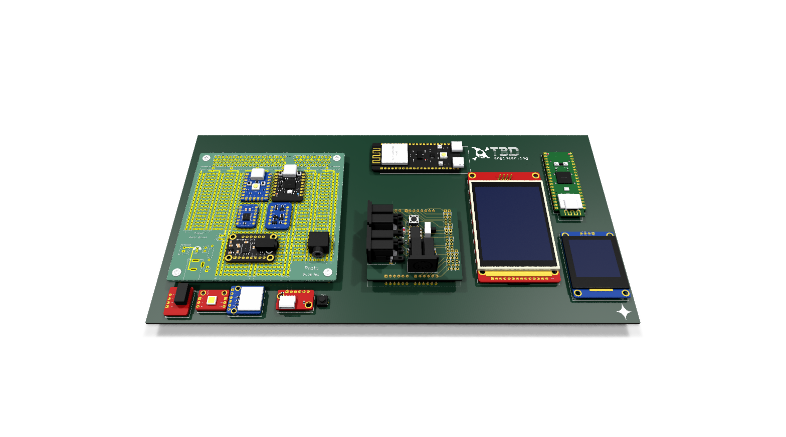
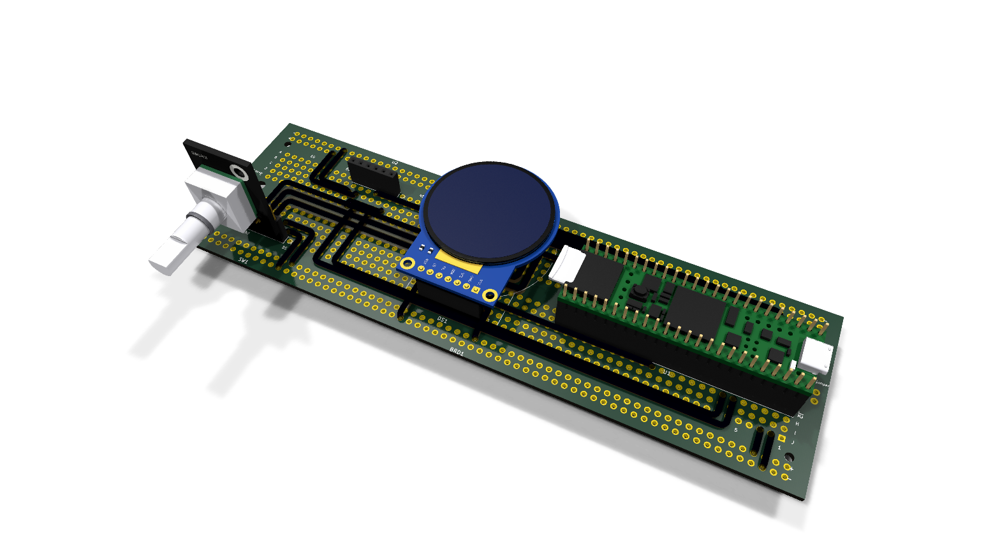

# tbd-kicad

KiCad 9 symbols, footprints and 3D models for hobby-electronics modules that are awkward to find ready-made:
development boards, display modules, audio DACs, level-shifter breakouts, an encoder module, optocouplers, solderable
breadboard and proto boards, a 3.5 mm jack and a MIDI shield. Each part is complete: a symbol with sensible pin types, a footprint
with the real hole pattern, a 3D body for the viewer, and a note on where every dimension came from.

Everything here is generated from Python scripts, so a measurement fix rebuilds the whole library consistently. Use
it under CC-BY-SA 4.0 with the KiCad library exception: designs made with it are yours, no attribution needed on boards.



## Parts

| Part | Symbol | Footprint | 3D | Geometry source |
|---|---|---|---|---|
| **Development boards** | | | | |
| PJRC Teensy 4.1 | `Teensy_4.1` | `Teensy41` | STEP + coloured VRML | XenGi library (exact) |
| Espressif ESP32-S3-DevKitC-1 (and N16R8 clones) | `ESP32-S3-DevKitC-1` | `ESP32-S3-DevKitC-1` | VRML + STEP | Espressif library (exact) |
| DFRobot Beetle RP2350 (DFR1188) | `Beetle_RP2350_DFR1188` | `Beetle_RP2350_DFR1188_THT`, `_SMD` | VRML + STEP (THT) | DFRobot CAD (exact) |
| Waveshare RP2040-Zero form factor | `RP2040-Zero` | `RP2040-Zero` | VRML + STEP | Waveshare drawing (edge pins exact, back pads approx.) |
| **Displays** | | | | |
| 2.8" ILI9341 SPI TFT, 14-pin (lcdwiki MSP2806/MSP2807) | `TFT_2.8in_ILI9341_SPI_MSP2806` | same | VRML + STEP | lcdwiki drawing (exact) |
| 1.28" round GC9A01 IPS, 7-pin | `GC9A01_Round_1.28in_7pin` | same | VRML + STEP | header exact, outline from photos |
| **Audio** | | | | |
| Adafruit PCM5102 / PCM5100 I2S DAC (6250 / 6251) | `Adafruit_PCM510x_I2S_DAC` | same | VRML + STEP | Adafruit EagleCAD (exact) |
| Lonely Binary TK103 PCM5102A I2S DAC (right-angle header) | `TK103_PCM5102A_I2S_DAC` | `TK103_Module_RA_Header` | vendor STEP, see note | vendor STEP (exact) |
| Kycon STX-3120-3B 3.5 mm stereo jack (Adafruit 1699) | `AudioJack_3.5mm_STX-3120-3B` | `Jack_3.5mm_Kycon_STX-3120-3B_Horizontal` | VRML + STEP | Kycon drawing (exact) |
| Arduino UNO MIDI shield (3x DIN-5, 6N138) | `MIDI_Shield_DIN5x3_6N138` | stock `Module:Arduino_UNO_R3_WithMountingHoles` | `MIDI_Shield_UNO` (attach by hand) | UNO header pattern (exact) |
| **Breakouts and modules** | | | | |
| Adafruit TXB0104 bi-directional level shifter (1875) | `Adafruit_TXB0104_Level_Shifter` | `Adafruit_TXB0104_Breakout` | VRML + STEP | Adafruit EagleCAD (exact) |
| Adafruit BSS138 4-channel I2C-safe level shifter (757) | `Adafruit_BSS138_4ch_Level_Shifter` | `Adafruit_BSS138_Level_Shifter` | VRML + STEP | Adafruit EagleCAD (exact) |
| KY-040 rotary encoder module (right-angle header) | `KY-040_Rotary_Encoder_Module` | `KY-040_Module_RA_Header` | VRML + STEP | header exact, board from photos |
| **Optocouplers** | | | | |
| Sharp PC900V OPIC photocoupler (MIDI in) | `PC900V` | stock `Package_DIP:DIP-6_W7.62mm` | stock | Sharp drawing (exact) |
| Toshiba TLP2962 15 MBd photocoupler | `TLP2962` | stock `Package_DIP:DIP-8_W7.62mm` | stock | Toshiba drawing (exact) |
| **Prototyping boards** | | | | |
| ElectroCookie full-size solderable breadboard PCB | (mechanical) | `ElectroCookie_Breadboard_Full` | | vendor drawing (exact), rails from photos |
| ProtoSupplies PSB-1 MCU proto board with DC input | (mechanical) | `ProtoSupplies_PSB-1` | | vendor drawing + CAD renders |

Also included: silkscreen logo footprints in two sizes each (`Logo_TBD_*`, `Logo_Star_*`), filled polygons on F.SilkS
with no pads, made by `tools/gen_logos.py` from a PNG. Point the script at your own artwork to make more.

`docs/components.md` describes each part, lists the source of every dimension, and flags what is still only estimated.

## Installing

Requires KiCad 9.0 (the files use the 9.0 formats).

1. Clone or download this repository somewhere permanent, for example `~/kicad/tbd-kicad`.
2. In KiCad, open *Preferences > Configure Paths* and add a variable `TBD_KICAD_DIR` whose value is that directory.
   The footprints reference their 3D models as `${TBD_KICAD_DIR}/lib/3d/...`, so without it the models do not show.
3. *Preferences > Manage Symbol Libraries*, Global tab: add `${TBD_KICAD_DIR}/lib/tbd.kicad_sym` with nickname `tbd`.
4. *Preferences > Manage Footprint Libraries*, Global tab: add `${TBD_KICAD_DIR}/lib/tbd.pretty` with nickname `tbd`.

Keep the nickname `tbd`: every symbol's Footprint field is pre-filled as `tbd:<footprint>`, so placing a symbol gives you
the footprint and 3D model with no further assignment. To use the library in a single project instead of globally,
copy `projects/teensy-panel/sym-lib-table` and `fp-lib-table` next to your project file and edit the paths.

Not using a path variable? Add the libraries by absolute path and run a find-and-replace of `${TBD_KICAD_DIR}` in
`lib/tbd.pretty/*.kicad_mod`; nothing else in the repository depends on it.

## Conventions

- **Pin numbers follow the module's silkscreen or vendor drawing**, counted the way you would read the board (the
  Teensy and ESP32 symbols keep their upstream numbering). Pin names are the names printed on the module.
- **Modules with right-angle headers** (KY-040, TK103) have a *carrier* footprint: a 1xN row of holes with the module
  standing perpendicular on the -Y side. The 3D model shows the module standing.
- **Modules with straight headers** are modelled sitting on soldered male headers, board 2.54 mm above the carrier.
- **Prototyping boards** name their pads after the net they belong to (`L12` for strip holes A-E of row 12 on the
  ElectroCookie, `G`, `V1`-`V7`, `VIN`, `a7` on the PSB-1), so every hole of a strip or rail carries the same pad
  number. The copper lines in those footprints are decoration for the 3D view; KiCad 9 does not treat same-numbered
  pads as connected, so add board-level tracks along the strips if you want the ratsnest to understand the board
  (`projects/teensy-panel` shows how).
- **Mounting holes** are non-plated unless the vendor board plates them (Adafruit's are plated).
- **Logo footprints** are board-only, excluded from the BOM and position files; flip them for the back side.

## How accurate is it

Exact means the geometry comes from vendor CAD, a dimensioned drawing or a STEP file; those parts are safe to drill from.
Items measured from photos (GC9A01 outline and holes, KY-040 board size, RP2040-Zero back pads, ElectroCookie rail
length, the PSB-1 input-section component positions) are close but should be checked with calipers before a panel is
cut. The PSB-1 footprint keeps its seven V bus columns as separate nets because the vendor renders show them as
separate copper; measure your board and set `PSB_V_COMMON = True` in `tools/gen_lib.py` if they are joined.

If you find an error, open an issue with a measurement or a drawing and it gets fixed in the generator.

## Example projects

- **`projects/teensy-panel`**: a Teensy 4.1 front panel (round display, encoder, I2S DAC) built on the ElectroCookie
  board. The PCB is a build guide rather than a fab file: sockets, modules and every jumper wire routed hole-to-hole and
  rendered as 22 AWG wire in the 3D viewer, with a wiring map (`WIRING.md`) and cut list (`WIRES.md`).
- **`projects/parts-preview`**: the board in the picture above, every other part placed for a look in the 3D viewer.



## Layout and regenerating

```
lib/tbd.kicad_sym         all symbols                   <- tools/gen_lib.py
lib/tbd.pretty/           all footprints                <- tools/gen_lib.py, tools/gen_logos.py
lib/3d/                   VRML + STEP bodies            <- tools/build_models.py (FreeCAD); Teensy STEP from XenGi
lib/vendor/               upstream files the generator reads, with their licences
artwork/                  logo sources and logos.json
docs/components.md        part reference and dimension sources
projects/                 example projects              <- tools/gen_teensy_panel.py, tools/gen_parts_preview.py
tools/                    the generators (Python 3, KiCad's pcbnew module for the projects, FreeCAD for the models)
```

```
python3 tools/gen_lib.py                        # symbols and footprints
freecad.cmd tools/build_models.py               # 3D bodies (run from a path FreeCAD can read; snap builds cannot see /tmp)
python3 tools/gen_logos.py artwork/logos.json   # logo footprints (needs potrace)
python3 tools/gen_teensy_panel.py               # projects/teensy-panel
python3 tools/gen_parts_preview.py              # projects/parts-preview
python3 -I tools/eagle_dump.py <board.brd>      # pads, outline and nets of an EagleCAD board, for new parts
```

Adding a part means adding a block to `gen_lib.py` (symbol pin list, pad coordinates, outline) and, if you want a body,
a builder in `build_models.py`. Checks used before committing: `kicad-cli sym export svg`, `kicad-cli fp export svg`,
`kicad-cli sch erc` on the example schematic and `kicad-cli pcb render` on the example boards.

## Vendor files

Redistributable upstream sources live in `lib/vendor/`: XenGi's Teensy library (MIT), Espressif's KiCad library
(CC-BY-SA 4.0, converted from the KiCad 10 format) and Adafruit's EagleCAD boards (CC-BY-SA 3.0). Vendor documents
without redistribution terms (DFRobot CAD, lcdwiki and Kycon drawings, the Lonely Binary STEP, ProtoSupplies renders)
stay in a private companion repository; the only visible effect is that the TK103 footprint's 3D model is absent here.

## Licence

Library content CC-BY-SA 4.0 with the KiCad library exception, tools MIT, vendored items under their own terms.
See `LICENSE.md`.
