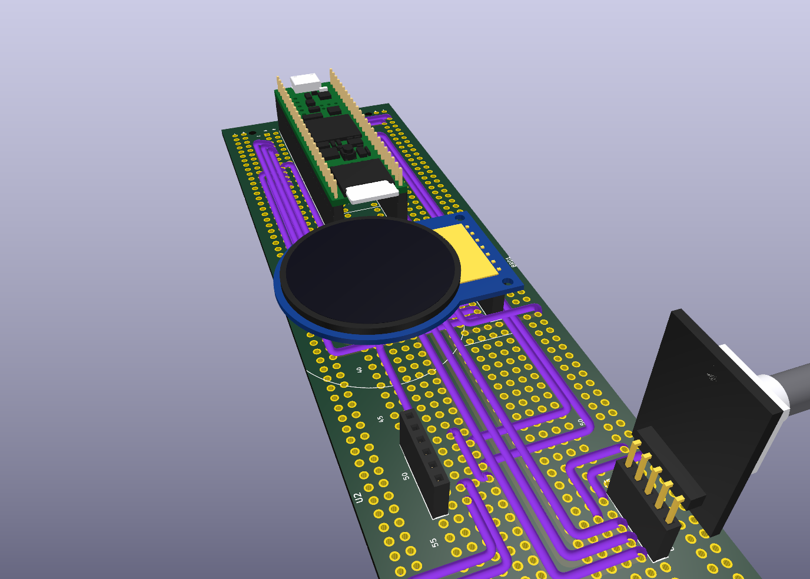

# tbd-kicad

KiCad 9 symbols, footprints and 3D models for the parts in my bench stock, plus the hand-wired projects that use them.
Everything is **generated from Python scripts** so a dimension fix rebuilds the whole library; nothing is hand-edited
in the KiCad editors.

| Part | Symbol | Footprint | 3D |
|---|---|---|---|
| PJRC Teensy 4.1 | `Teensy_4.1` | `Teensy41` | coloured VRML + STEP |
| DFRobot Beetle RP2350 (DFR1188) | `Beetle_RP2350_DFR1188` | `..._THT`, `..._SMD` | |
| 2.8" ILI9341 SPI TFT (lcdwiki MSP2806/2807) | `TFT_2.8in_ILI9341_SPI_MSP2806` | same | |
| 1.28" round GC9A01, 7-pin | `GC9A01_Round_1.28in_7pin` | same | VRML + STEP |
| KY-040 rotary encoder module | `KY-040_Rotary_Encoder_Module` | `KY-040_Module_RA_Header` | VRML + STEP |
| RP2040-Zero form factor | `RP2040-Zero` | same | |
| ESP32-S3-DevKitC-1 | `ESP32-S3-DevKitC-1` | same | |
| Lonely Binary TK103 PCM5102A I2S DAC | `TK103_PCM5102A_I2S_DAC` | `TK103_Module_RA_Header` | vendor STEP, see below |
| Arduino UNO MIDI shield (DIN x3, 6N138) | `MIDI_Shield_DIN5x3_6N138` | stock `Module:Arduino_UNO_R3_WithMountingHoles` | |
| ElectroCookie full-size breadboard PCB | (mechanical) | `ElectroCookie_Breadboard_Full` | |

Silkscreen logos (filled polygons on F.SilkS, no pads, excluded from BOM and position files), each in two sizes:
`Logo_TBD_Full` (40/80 mm), `Logo_TBD_Head` (8/16), `Logo_TBD_Wordmark` (15/30), `Logo_TBD_engineering` (15/30)
and `Logo_Star` (5/10). Place them like any footprint; flip to the back for B.SilkS.

`docs/components.md` describes each part, cites the source of every dimension, and lists what is still only estimated
(measure the GC9A01 outline, the KY-040 board and the RP2040-Zero back pads before relying on them).

## Layout

```
lib/tbd.kicad_sym         all symbols                     <- tools/gen_lib.py
lib/tbd.pretty/           all footprints                  <- tools/gen_lib.py
lib/3d/                   STEP + VRML models              <- tools/build_models.py (FreeCAD) and XenGi
lib/vendor/               redistributable upstream files the generator reads (licences alongside)
artwork/                  logo sources + logos.json spec           -> tools/gen_logos.py
docs/components.md        part reference and dimension sources
projects/teensy-panel/    Teensy 4.1 + GC9A01 + KY-040 + TK103 on an ElectroCookie board
tools/                    generators
```

## Using the library

Add `lib/tbd.kicad_sym` and `lib/tbd.pretty` in *Preferences > Manage Symbol/Footprint Libraries* with nickname
`tbd`, or copy `projects/teensy-panel/sym-lib-table` and `fp-lib-table` into your project (they reference the library
through `${KIPRJMOD}/../../lib`, so they work for any project under `projects/`). Footprints reference 3D models as
`${KIPRJMOD}/../../lib/3d/...`.

## teensy-panel

A front panel for a MIDI synth module: Teensy 4.1 socketed on an ElectroCookie breadboard PCB, a 1.28" round display,
a rotary encoder and an I2S DAC. The schematic passes ERC; the PCB is not for fabrication but a **build guide**: the
breadboard, the sockets, the modules on them, and every jumper wire routed hole-to-hole and rendered as a purple 22 AWG
wire in the 3D viewer.



- `WIRING.md`: Teensy pin to breadboard hole map and socket positions.
- `WIRES.md`: cut list, one line per wire with its route and length.
- `teensy-panel-wiring-top.png`, `teensy-panel-wiring-2d.svg`: the wiring diagram.

The breadboard strips, rails and wires are also laid down as KiCad tracks so the ratsnest and DRC understand the build;
the only two airwires left are the two rail solder jumpers. Ignore the clearance and co-located-hole DRC errors, they
come from several footprints sharing the breadboard holes.

## Regenerating

```
python3 tools/gen_lib.py            # lib/tbd.kicad_sym, lib/tbd.pretty/
python3 tools/gen_teensy_panel.py   # projects/teensy-panel/*
freecad.cmd tools/build_models.py   # lib/3d/{KY-040_Module,GC9A01_Round_1.28in_7pin,Teensy_4.1_Assembly}.*
python3 tools/gen_logos.py artwork/logos.json   # Logo_* footprints (edit "widths" in the spec for other sizes)
```

`gen_logos.py` traces the ink with potrace, scales it, fractures holes with KiCad's polygon engine and writes one
filled `fp_poly` per piece. Pixel art is traced with smoothing off (`alphamax: 0`); smooth artwork with it on.

Checks used: `kicad-cli sym export svg`, `kicad-cli fp export svg`, `kicad-cli sch erc`, `kicad-cli pcb render`, and
`pcbnew` from Python for connectivity. Needs KiCad 9.0.x; the Espressif upstream is in KiCad 10 format and the generator
strips the tokens KiCad 9 rejects.

## Private overlay

Vendor files without redistribution terms (DFRobot CAD and PDFs, the lcdwiki size drawing, Waveshare images, the
Lonely Binary guide and TK103 STEP) and the product photos the estimates were made from live in a separate private
repository. Copy its `overlay/` onto this checkout to get the TK103 3D model; everything else here works without it.

## Licence

Library content CC-BY-SA 4.0 (with the KiCad library exception), tools MIT; vendored Teensy (MIT) and Espressif
(CC-BY-SA 4.0) items keep their terms. See `LICENSE.md`.
